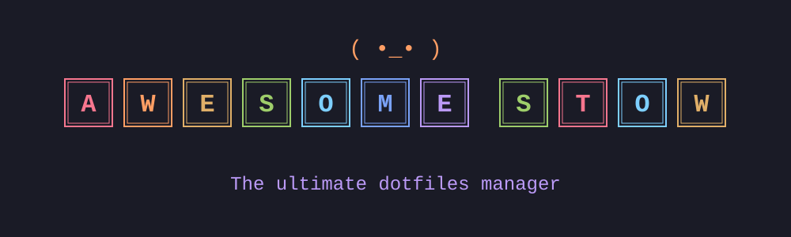
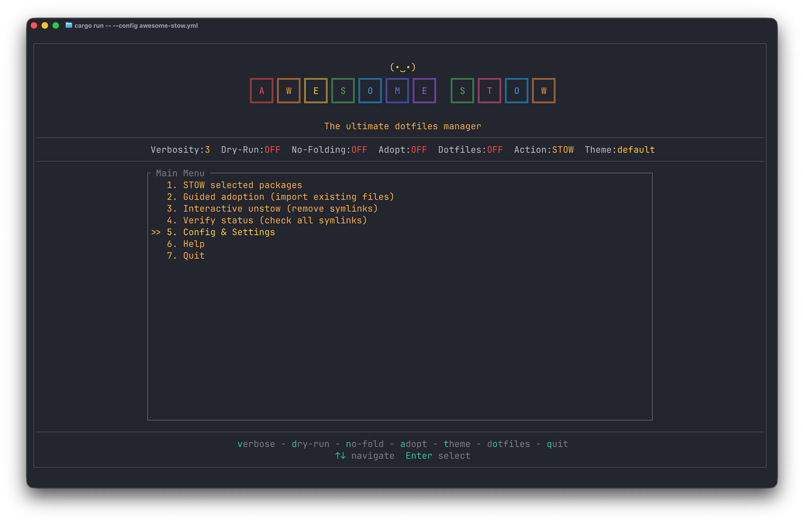
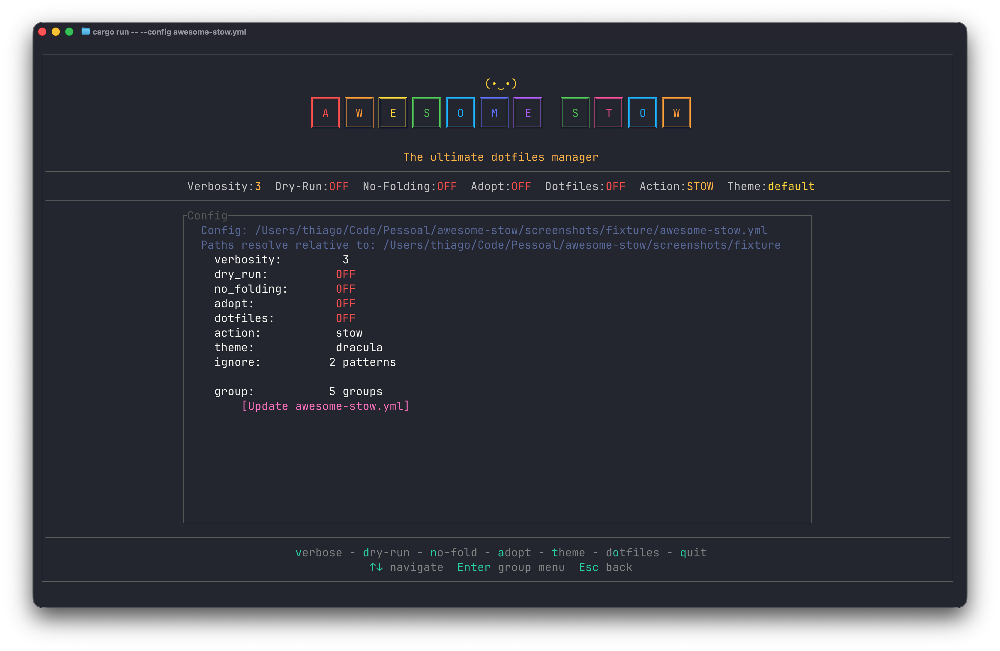
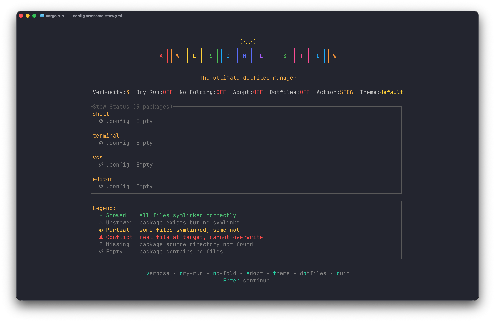
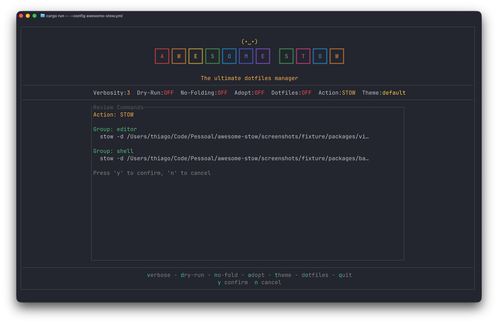

<p align='center'>
  
</p>

<p align='center'>
  
  
</p>

# andre 🚀

**A.N.D.R.E.** — *Another Neat Dotfile Repository Engine*. Manage your dotfiles from a terminal, with a built-in native engine (GNU Stow optional).

## 📋 Table of Contents

- [What is andre?](#what-is-andre)
- [Features](#features)
- [Screenshots](#screenshots)
- [Installation](#installation)
- [Quick Start](#quick-start)
- [Main Menu](#main-menu)
- [Key Bindings](#key-bindings)
- [Detailed Reference](#detailed-reference)
- [License](#license)

<a name="what-is-andre"></a>
## 🎯 What is andre?

**GNU Stow** is a CLI symlink farm manager. It creates symlinks from a source directory to a target directory — most commonly used to keep dotfiles in a version-controlled repo while making them appear in your home directory.

**andre** implements the same model, with a terminal UI on top. Instead of remembering CLI flags and running stow manually per package group, you get a visual interface to mark groups and packages, toggle options, and execute with live feedback. It runs on its own **native** engine by default, so no external binary is required; set `global.engine: stow` if you want it to drive GNU Stow itself.

See [REFERENCE.md](REFERENCE.md) for a detailed walkthrough and full configuration reference.

<a name="features"></a>
## ✨ Features

- **Multi-group config** — Define multiple stow targets (e.g., `~`, `~/.config`) each with its own source directory
- **Interactive package selection** — Browse packages per group, select/unselect with Space, smart pre-selection based on action
- **Live settings toggles** — Toggle dry-run, verbosity, adopt, no-folding on the fly from any screen
- **Config editor built-in** — Edit `andre.yml` from within the TUI: add/remove/edit groups, change global defaults
- **Headless mode (`--yolo`)** — Auto-stow all packages without interaction, for scripts and automation
- **Config folder and profiles** — One config folder (`~/.config/andre/` or `--config-folder`) holds `andre.yml` and named package profiles that can include each other
- **Real stow status display** — See which packages are stowed, unstowed, conflicted, or missing at a glance

<a name="screenshots"></a>
## 📸 Screenshots

| Screen | Preview |
|--------|---------|
| *Main Menu* |  |
| *Settings* |  |
| *Status* |  |
| *Execute* |  |

<a name="installation"></a>
## 📦 Installation

Install methods are **Homebrew** and **from source** (no new prebuilt binaries
are published; the v1.0.0-rc1 release retains its historical assets).

### Homebrew (macOS / Linux)

```bash
brew install lthiagol/tap/andre
```

Brew auto-taps the GitHub-hosted tap (`lthiagol/homebrew-tap`) on first
install, so no manual `brew tap` step is needed.

Installs Rust.
**Note**: the formula builds andre from source, which pulls in the Rust toolchain (and LLVM + z3 as transitive dependencies, ~1 GB total). To avoid that, install Rust via [rustup](https://rustup.rs) and use `cargo install` or the from-source steps below.

GNU Stow is **optional**: the default `engine: native` is built in and needs no external binary. Install [GNU Stow](https://www.gnu.org/software/stow/) only if you set `global.engine: stow` in `andre.yml` (or need `adopt` / `dotfiles`).

### From source

```bash
git clone https://github.com/lthiagol/andre
cd andre
make install
```

### Via cargo

```bash
cargo install --git https://github.com/lthiagol/andre
```

<a name="quick-start"></a>
## 🚀 Quick Start

Create an `andre.yml` in your dotfiles directory:

```yaml
# Minimal working example — see REFERENCE.md for full reference
packages: packages/dotfiles   # every subfolder is a package
target: "~"                   # optional; where links go (default: your home folder)

global:
  stow:
    verbosity: 0
    dry_run: false
    no_folding: false
    adopt: false
    action: stow
```

andre reads the config from `~/.config/andre/` (or `$XDG_CONFIG_HOME/andre/`). To use another file or folder:

```bash
andre --config ~/dotfiles/andre.yml
andre --config-folder ~/src/dots   # a folder holding andre.yml and profiles/
andre --yolo --profile work        # headless: stow only the packages of profiles/work.yml
```

See [REFERENCE.md](REFERENCE.md#full-configuration-reference) for the discovery order and profile files.

Launch without arguments:

```bash
andre
```

Mark the packages you want (`Space`), then press `Enter` to stow them.

<a name="main-menu"></a>
## 🗺️ Main Menu

The main menu lists the actions on the left. The panel on the right describes
the selected one and shows what it touches: group and package counts, how many
packages are stowed once their status has been checked (`–` until then), and
the target directories. Move with `↑`/`↓`, or press `1`–`8` to jump to an
action. On a fresh machine whose config folder is not yet linked to `~/.config/andre`,
the first item, `set up this machine`, links it (`0`). Every other screen shows a one-row title with its breadcrumb instead of
the full banner. On the list screens the cursor row is filled with the theme's
selection colour and marked with a `▌` bar.

| Option | What it does |
|--------|-------------|
| **profiles** | Named sets of packages. Pick one and run the current action on all of it |
| **packages** | Select groups and packages, then run the current action (stow, restow or unstow) |
| **new package** | Create a package: empty, or from files that already sit in a target; sets its ignore files and profiles |
| **unstow** | Remove symlinks interactively |
| **verify status** | View stow status across all groups |
| **settings** | Edit config, add/remove groups, change options |
| **help** | Keyboard reference |
| **quit** | Exit andre |

<a name="key-bindings"></a>
## ⌨️ Key Bindings

| Key | Action |
|:---|:---|
| `↑↓` or `kj` | Navigate |
| `Enter` | Confirm / Select |
| `Space` | Toggle selection |
| `Escape` | Back / Cancel |
| `s` | Cycle the action: stow, restow, unstow |
| `v` | Cycle verbosity (0-5) |
| `d` | Toggle dry-run |
| `t` | Cycle theme |
| `q` / `Ctrl+C` | Quit |

Global shortcuts work from list screens. They are blocked during text input (e.g., typing a package name in the new-package wizard) and modal popups (e.g., settings picker).

Icons default to the Nerd Font set. If your terminal font is not a [Nerd Font](https://www.nerdfonts.com/), set `global.icons: unicode` in `andre.yml` (or pick it in Settings) to use plain symbols instead.

<a name="detailed-reference"></a>
## 📖 Detailed Reference

For full documentation — complete configuration reference, all key bindings, themes, testing guide, build dependencies, and contributing — see [REFERENCE.md](REFERENCE.md).

<a name="license"></a>
## 📝 License

MIT
